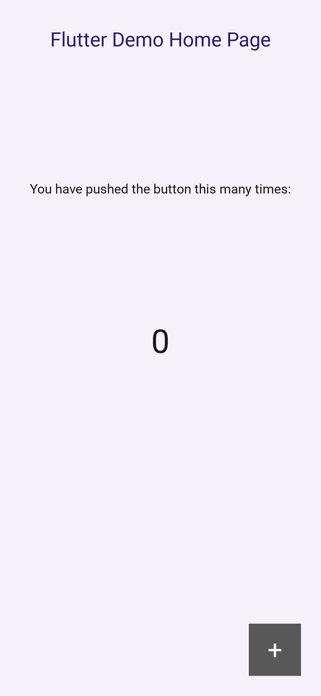
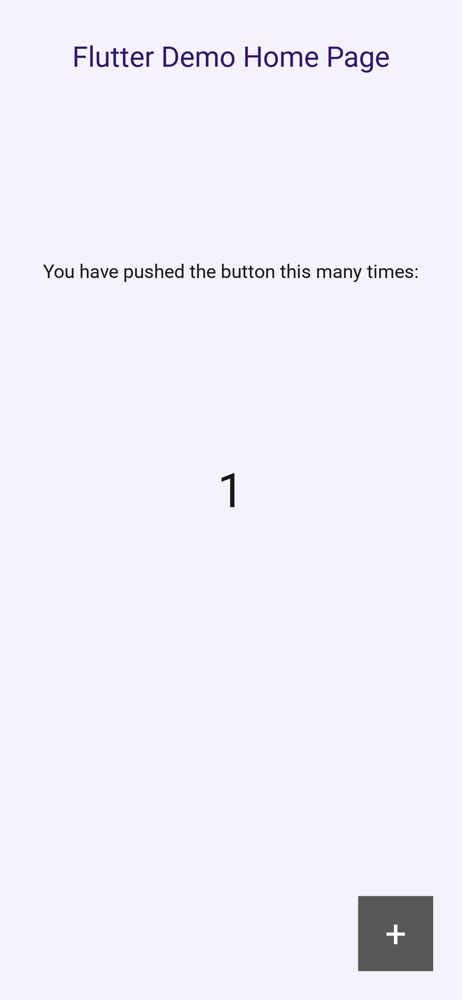

# Kivy Screenshot Generator
Generate screenshots for a Kivy application across different screens and languages.

A Python/Kivy port of [flutter_screenshot_generator](https://pub.dev/packages/flutter_screenshot_generator).

## Installation

```
# requirements.txt
kivy-screenshot-generator @ git+https://github.com/lyskouski/kivy_screenshot_generator.git@v1.0.0
```

On Linux, install `xvfb` (`sudo apt install xvfb`): screenshots are rendered in a virtual display, so
devices larger than your monitor keep their exact resolution and no windows pop up.

## Implementation

```python
# ./example/capture.py
from kivy_screenshot_generator import ScreenshotGenerator


def get_app():
    # Imported here: the Kivy window must be created after the device settings are applied
    from main import MyApp
    return MyApp(locale=gen.job.locale)


async def tap(tester):
    await tester.tap(tester.find_by_id('add'))
    await tester.pump()


gen = ScreenshotGenerator(locales=['en_US', 'de_DE'], fn_get_app=get_app)
gen.inject('1_home')
gen.inject('2_tap', before=tap)

if __name__ == '__main__':
    gen.run()
```

Each screenshot is taken by a fresh process running the same script with the device's window size (in
physical pixels) and pixel density (`dp`/`sp`), so every step starts from a newly built app. Results are
stored as `screenshots/<locale>/<device>/<step>.png`.

- `fn_get_app()` returns the App instance (not running yet). Import the app inside it: a window
  created on import would get the default size.
- `fn_init(device, config, locale)` (optional, sync or async) runs before `fn_get_app`, e.g. to prepare
  preferences or an isolated profile directory.
- `gen.job` holds the current `step`, `device` and `locale` inside the screenshot process. The app can
  also read `SCREENSHOT_DEVICE`, `SCREENSHOT_PLATFORM`, `SCREENSHOT_LOCALE` and `SCREENSHOT_STEP`.

### Steps

`before` receives a `ScreenshotTester` (the counterpart of Flutter's `WidgetTester`):

| Method | Description |
| --- | --- |
| `await pump(duration=None)` | Process events and redraw (a couple of frames or `duration` seconds) |
| `await pump_and_settle(duration=0.1, timeout=10)` | Wait until animations and screen transitions finish |
| `find(predicate, index=0)`, `find_all(predicate)` | Widgets of the window, including popups and dropdowns |
| `find_by_id(id)`, `find_by_text(text, exact=True)`, `find_by_type(cls_or_name)` | Common finders |
| `await tap(widget)`, `await long_press(widget)`, `await drag(widget, dx, dy)` | Touches through the regular input pipeline |
| `await enter_text(widget, text)` | Focus a `TextInput` and set its text |
| `await show_screen(name)` | Switch the root `ScreenManager` |
| `app`, `window` | The running app and the Kivy window |

### Configuration

```python
from kivy_screenshot_generator import ScreenshotConfig, ScreenshotPresets

# Presets: comprehensive() (default), mobile_only(), ios_only(), android_only(), desktop_only(), ci_optimized()
config = ScreenshotPresets.mobile_only()
config.output_directory = 'docs/screenshots'
config.workers = 4

ScreenshotGenerator(locales=['en_US'], fn_get_app=get_app, config=config)
```

| Field | Default | Description |
| --- | --- | --- |
| `enabled_platforms` | all but `linux` | `ios`, `android`, `macos`, `windows`, `linux` |
| `enabled_device_types` | all | `phones`, `tablets`, `desktops` |
| `output_directory` | `screenshots` | Root folder of the results |
| `animation_settle_time` | `0.5` | Seconds to wait after the step before capturing |
| `headless` | auto | Use `xvfb-run` (auto: on Linux when installed); otherwise a hidden window is used |
| `workers` | `1` | Screenshots taken in parallel |
| `timeout` | `180` | Seconds before a screenshot process is killed |
| `log_level` | `warning` | Kivy log level of the screenshot processes |

Devices are listed in `PlatformDevices` (iPhones, iPads, Android phones and tablets, desktops) with the
sizes required by Apple App Store and Google Play.

## Usage

```
# Run all
python capture.py

# Limit by devices
SCREENSHOT_DEVICES="iPhone 15 Pro" python capture.py

# Limit by languages
SCREENSHOT_LOCALES=en_US python capture.py

# Limit by steps
SCREENSHOT_STEPS=2_tap python capture.py

# Skip devices for which a folder already exists
SKIP_EXISTANT=true python capture.py

# Parallel processes / force or disable the virtual display
SCREENSHOT_WORKERS=4 SCREENSHOT_HEADLESS=1 python capture.py
```

The exit code is non-zero when any screenshot fails; the output of the failed process is printed.

## Results: iPhone 14

 . 

## Production example
[https://github.com/lyskouski/app-language/blob/main/tools/capture_screenshots.py](https://github.com/lyskouski/app-language/blob/main/tools/capture_screenshots.py)

## Development

```
pip install -e .[test]
pytest
```

## Support (Sponsorship)

If you'd like to contribute financially towards the efforts, please consider these options:

* [Github Sponsorship](https://github.com/users/lyskouski/sponsorship)
* [Paypal](https://www.paypal.me/terCAD)
* [Patreon](https://www.patreon.com/terCAD)
* [Donorbox](https://donorbox.org/tercad)

Or, [buy a coffee](https://www.buymeacoffee.com/lyskouski).
